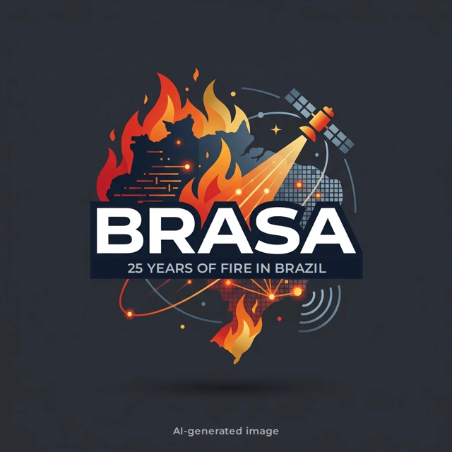
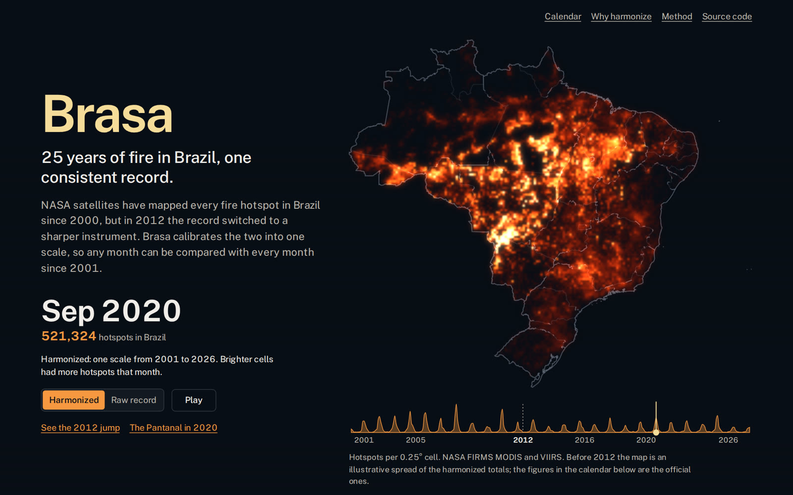
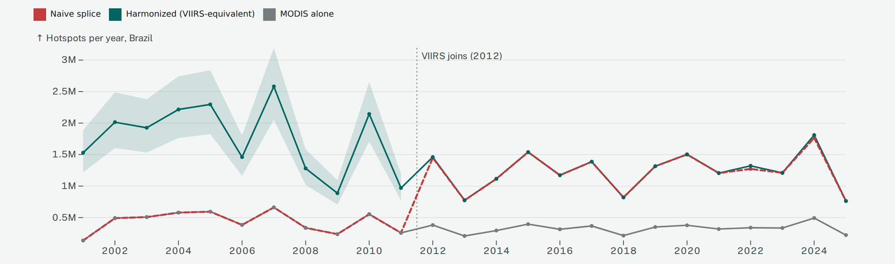
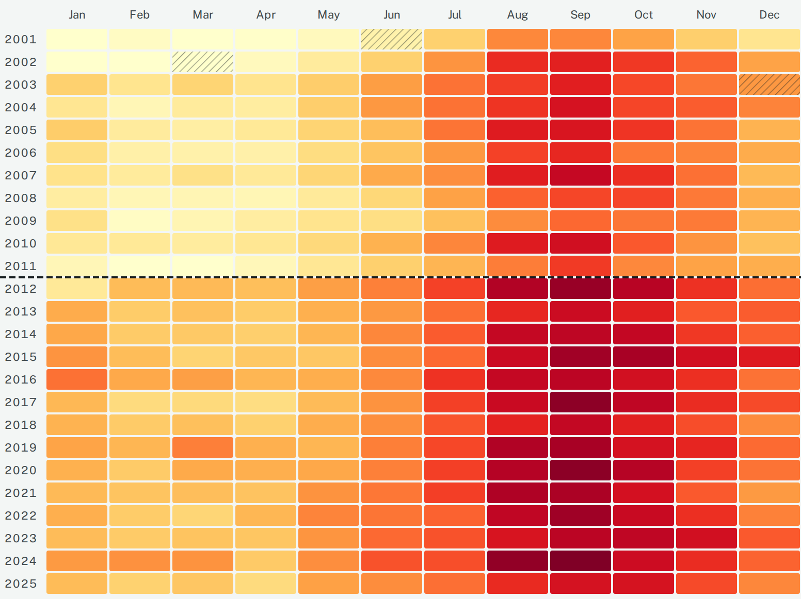
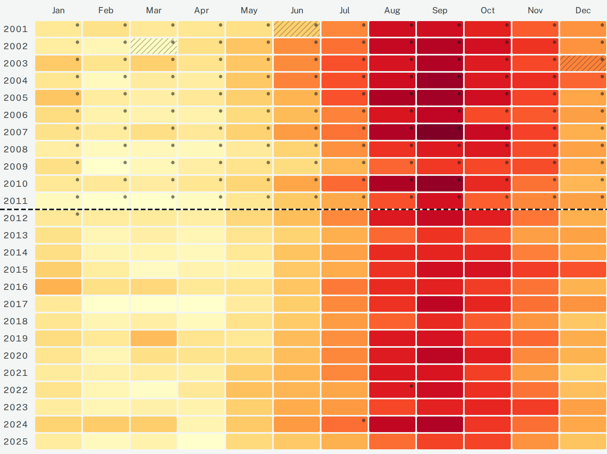
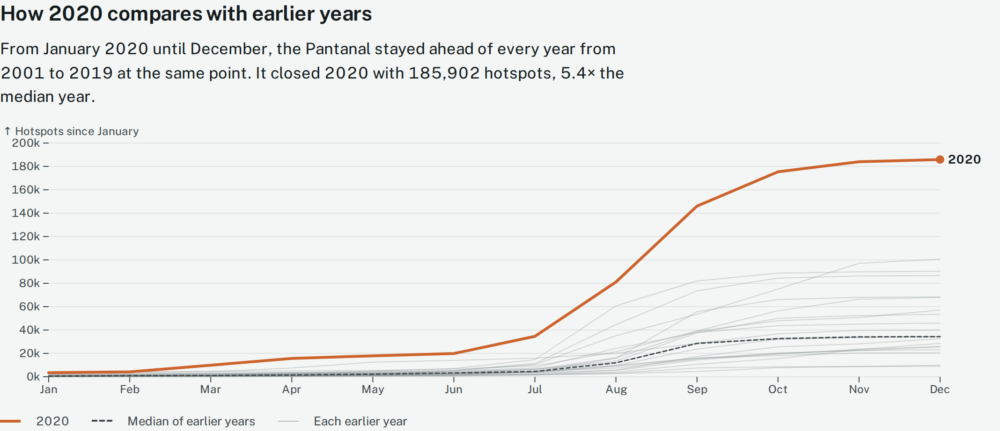
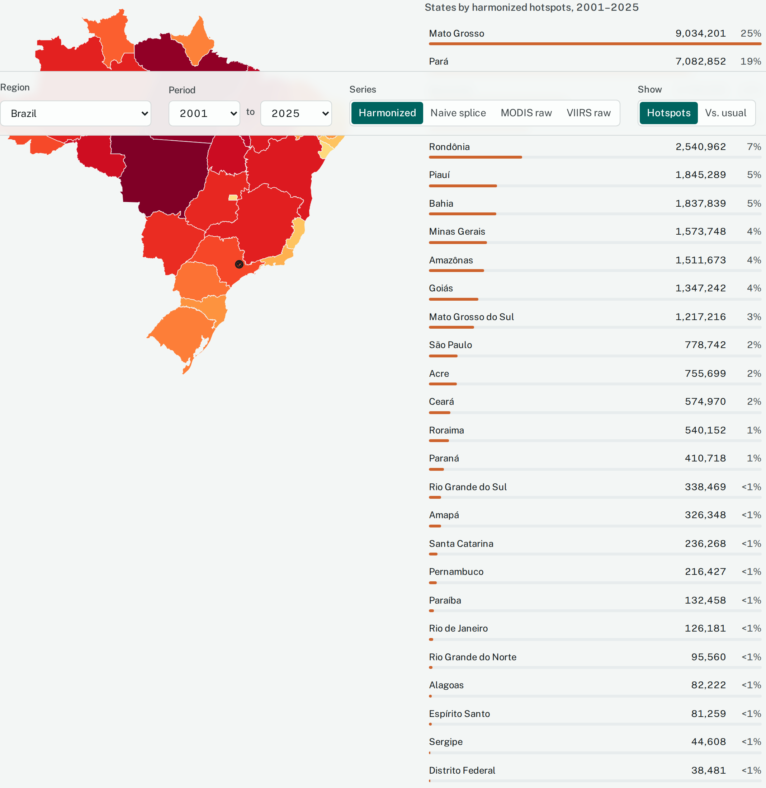

<p align="center"></p>

# Brasa

**25 years of fire in Brazil, one consistent record.** *Brasa* is Portuguese for *ember*.

In January 2012 Brazil appeared to start burning three times as much as before. It didn't. The record had switched to a sharper satellite instrument, while the old one kept flying. Brasa removes that artefact. It calibrates the old MODIS record (since 2000) against VIIRS (since 2012), using the 14 years in which both flew together. The result is one month-by-month fire calendar, from 2001 to 2025 plus 2026 so far (January to October, provisional), for Brazil, its 6 biomes, its 27 states and the Campinas Metro Area. On a consistent record, this year can be compared with every year since 2001, months before the fire season peaks.

**[Open the calendar](https://brasa-br.github.io/calendar/)** | [30-second demo](<VIDEO_URL>) | [Method](docs/METHODOLOGY.md) | [Design decisions](docs/DECISIONS.md) | [Download all data (CSV)](web/public/data/all_regions_monthly.csv)

Built in Campinas for the NASA Space Apps Challenge 2026, for the challenge *Harmonization of MODIS and VIIRS Hot Spots*.

<a href="https://brasa-br.github.io/calendar/"></a>

**Contents:** [The 2012 trap](#the-2012-trap) | [What the consistent record shows](#what-the-consistent-record-shows) | [Early warning](#early-warning-how-this-year-compares) | [Use it](#use-it) | [How it works](#how-it-works) | [Run it yourself](#run-it-yourself) | [Limits](#limits) | [Team](#team) | [Data and credits](#data-and-credits)

<picture>
  <source media="(prefers-color-scheme: dark)" srcset="docs/img/before-after-dark.png">
  
</picture>

<sub>Annual hotspots in Brazil. Red: the two records joined as they are. Green: Brasa, on a single VIIRS-equivalent scale, with a 90% band where values are estimated. Grey: MODIS alone, which never changed sensor.</sub>

---

## The 2012 trap

The two instruments see the same fires differently. VIIRS has 375 m pixels and MODIS has 1 km pixels, so VIIRS picks up small fires that MODIS misses. Over the months both sensors observed Brazil, **VIIRS reported 3.77 hotspots for every MODIS hotspot**.

The two calendars below show the same months and use the same colour scale.

| Naive splice: MODIS until 2011, then VIIRS | Brasa: harmonized |
|---|---|
| <picture><source media="(prefers-color-scheme: dark)" srcset="docs/img/calendar-naive-dark.png"></picture> | <picture><source media="(prefers-color-scheme: dark)" srcset="docs/img/calendar-harmonized-dark.png"></picture> |

In the naive splice, the rows change colour at the dashed 2012 line, as if the country had caught fire overnight. After harmonization the line no longer stands out. The small dots mark months estimated from MODIS, and the hatched cells mark months with reduced satellite coverage.

The trend tests on Brazil's annual totals give the same verdict:

| Brazil, 2001–2025 | Step from 2009–11 to 2012–14 | Change point (Pettitt) | Trend (Mann-Kendall + Sen) |
|---|---|---|---|
| Naive splice | **3.19×** | 2012, p < 0.001 | **+5.6% per year**, p < 0.001 |
| Brasa, harmonized | **0.84×** | none at 2012 | −2.1% per year, p = 0.038 |
| MODIS alone (reference, no sensor change) | 0.84× | none at 2012 | −1.6% per year, p = 0.18 |

The harmonized step equals the MODIS-only step to two decimal places. The rise in the naive record came from the sensor change, not from more fires.

---

## What the consistent record shows

All counts below are harmonized hotspots (VIIRS-equivalent) for 2001–2025. They come from [`all_regions_monthly.csv`](web/public/data/all_regions_monthly.csv) and can be checked in the site.

**Brazil burns in three months.** August, September and October hold **71%** of all hotspots, and September alone holds 31%. The largest month in the record is **September 2007, with about 1.0 million hotspots**. The years with the most hotspots are 2007, 2005 and 2004. The years with the fewest are **2025** (763,000), 2013 and 2018.

**Each biome has its own calendar:**

| Biome | Hotspots 2001–2025 | Peak month | Share in its top 3 months | Most hotspots in one year | Out-of-sample R² |
|---|---:|---|---:|---|---:|
| Amazon | 19.1 M | Sep | 72% | 2005 (1.65 M) | 0.98 |
| Cerrado | 12.3 M | Sep | 77% | 2010 (1.11 M) | 0.97 |
| Atlantic Forest | 2.8 M | Sep | 56% | 2003 | 0.98 |
| Caatinga | 2.5 M | **Oct** | 69% | 2007 | 0.96 |
| Pantanal | 1.3 M | Sep | 71% | **2020 (185,902)** | 0.98 |
| Pampa | 0.14 M | **Aug** | 46% | 2020 | 0.89 |

- **The Cerrado has the most concentrated fire season:** 77% of its hotspots fall in August–October.
- **The Caatinga peaks a month later**, in October.
- **The Pampa has the least seasonal fire regime** of the six biomes and peaks in August, in the southern winter.
- **The Pantanal's worst year is 2020.** In 2025 it had 5,280 hotspots, its lowest complete year in the record.

**The Campinas Metro Area** is small and rarely burns, so it shows the method at its limits. It had 22,852 hotspots in 25 years. Its season comes earlier, peaking in August, with 2010 as its worst year. Its out-of-sample R² is 0.68, the lowest of all 35 regions, so its uncertainty bands are wide, and the site shows them.

---

## Early warning: how this year compares

Fire crews and budgets are planned around the usual season. Brasa adds up a year's hotspots month by month and draws every earlier year behind it. A year that runs ahead of all of them is a warning months before the peak. This comparison only works on a harmonized record: on the naive splice, every year since 2012 looks like a record year.

<picture>
  <source media="(prefers-color-scheme: dark)" srcset="docs/img/season-pantanal-2020-dark.png">
  
</picture>

**The Pantanal in 2020.** That year about 30% of the Brazilian Pantanal burned: 44,998 km², according to Shimabukuro et al. (2023). On the harmonized record, the signal was visible early:
- **January 2020:** the Pantanal was already ahead of every year from 2001 to 2019 at the same point, and it stayed ahead until December.
- **End of June:** two months before the usual peak, it had 19,877 hotspots. That was 6.1× the 2001–2019 median for that point of the year, and more than any earlier year had by then (the previous highest was 14,086, in 2009).
- **End of the year:** 2020 closed with 185,902 hotspots, 5.4× the median year.
- **Record months:** January, March, April, July, August, September and October each set a record for their month.

**Does the warning work beyond one case?** The same comparison was replayed on all 35 regions (Brazil, 6 biomes, 27 states and the Campinas Metro Area) for every year from 2006 to 2025, each time using only the years before it: 700 region-years. A year counts as severe when it ends with at least 2× the median of the years before it; 19 did.

| Ahead of every earlier year by the end of | Severe years caught (of 19) | False alarms | Flagged year turned severe | Unflagged year turned severe |
|---|---|---|---|---|
| June | 11 | 24 | 31% | 1.2% |
| July | 15 | 22 | 41% | 0.6% |
| August | 13 | 21 | 38% | 0.9% |

- **Lead time:** 16 of the 19 severe years were ahead of every earlier year before their peak month, a median of 6 months before it.
- **Misses:** the three that were not are all Roraima (2016, 2019, 2024), where the season peaks between January and March.
- **False alarms are not quiet years:** flagged by the end of July but under the severe line, they still ended a median 1.3× their usual year.

It is a screening signal, not a forecast: a flagged year was about 70 times more likely to turn severe than an unflagged one, but most flags still end below 2×. The site shows this table under the chart, and a **Where this year stands** list ranks every region by how this year compares so far. Computed by `pipeline/backtest.py` into `warning.json`.

Open this case at `?r=BIOME_PAN&to=2020`. With the current year's data from the FIRMS API (see [Run it yourself](#run-it-yourself)), the same panel follows the year as it unfolds.

---

## Use it

The site opens on an animated map: every 0.25° cell of Brazil glows with its hotspots, month by month from 2001 to October 2026, over the national monthly curve. Switch it between **Harmonized** and **Raw record** to watch the 2012 jump appear and disappear, or drag the timeline to any month. *See the 2012 jump* plays that story, and three guided views outline a region through its worst dry season: *The Pantanal in 2020*, *The Cerrado in 2010* (its worst year on the harmonized record, but only 15th on the raw one, below every year since 2012) and *Amazonas in 2024* (the state's worst year, 2.9× the median). Each story has its own link: `?story=2012`, `?story=pantanal`, `?story=cerrado` or `?story=amazonas`. With reduced motion turned on, the map opens still, on September 2020.

**Compare two regions** puts any pair side by side for the selected period: median year, worst year, peak month and trend, then each year as a multiple of the region's own median year and the share of the year's hotspots in each month. A small region and a large one can share one chart, for example the Campinas Metro Area and the state of São Paulo.

The map is illustrative before 2012: each cell's MODIS detections are scaled by its biome's harmonized/MODIS ratio for that month, then to the national total. The calendar below it carries the official figures.

The site is static: there is no login and nothing to install. All of its state is kept in the URL, so any view can be shared as a link.

| Parameter | Values | Example |
|---|---|---|
| `r` | `BR`, `BIOME_AMZ` `BIOME_CER` `BIOME_MAT` `BIOME_CAA` `BIOME_PAN` `BIOME_PAM`, `UF_AC` … `UF_TO`, `RMC` | `?r=BIOME_PAN` |
| `from`, `to` | Years from 2001 to the latest year. `to` is also the year compared in the early-warning panel | `?from=2015&to=2025` |
| `s` | `harmonized` (default), `naive`, `modis`, `viirs` | `?s=naive` shows the 2012 trap |
| `v` | `counts` (default), `anomaly` (log2 against that calendar month's mean over the selected years) | `?r=BIOME_PAN&v=anomaly` shows 2020 |
| `map` | `states` (default), `biomes` | `?map=biomes` |

**Accessibility:**
- The colour scales are colour-blind safe: YlOrRd for counts and PuOr for anomalies.
- The calendar is a single tab stop. Arrow keys move between months, and the tooltip is announced.
- Every calendar has a table version.
- The map has a ranked list beside it, so no value depends on colour alone.
- Light and dark themes follow the system setting.
- The layout works from 375 px wide.

<picture>
  <source media="(prefers-color-scheme: dark)" srcset="docs/img/map-dark.png">
  
</picture>

### Data you can download

[`web/public/data/all_regions_monthly.csv`](web/public/data/all_regions_monthly.csv) holds all 35 regions with one row per month from 2000-11 to 2026-10 (about 600 KB; 2026 is provisional). The download button on the site exports the current selection in the same format.

| Column | Meaning |
|---|---|
| `region` | Region id, as in the `r` parameter above |
| `month` | `YYYY-MM` |
| `harmonized` | Hotspots on the VIIRS-equivalent scale. **Use this column for comparisons across years.** |
| `lo`, `hi` | 90% prediction interval. It equals `harmonized` where VIIRS was observed. |
| `source` | Where the value comes from: `viirs_observed`; `harmonized_modis` (2001–2011, from Terra + Aqua); `modis_terra_adjusted` (Nov 2000 to Aug 2002, when only Terra was flying); `modis_gapfill` (a VIIRS outage filled from calibrated MODIS); `viirs_provisional` (current year, from the FIRMS API) |
| `modis_raw`, `viirs_raw` | Raw counts of each sensor after cleaning. `viirs_raw` is empty before 2012. |
| `naive` | The splice as it would be without harmonization: MODIS until 2011, then VIIRS |
| `qa_flag` | `1` when satellite coverage that month was reduced (fewer than 80% of days with data) and no other sensor could replace it |

Each region also has its own `web/public/data/series/<region>.json`. `meta.json` holds the fitted model parameters, the cross-validation results and the sensitivity tests.

---

## How it works

```
NASA FIRMS yearly archives (40 CSVs, 2.2 GB) + FIRMS Area API for 2026
  │  MODIS C6.1 Terra+Aqua 2000–2025 · VIIRS S-NPP 375 m 2012–2025 · 2026 so far, provisional
  ▼
clean ── vegetation fires only (type 0), nominal/high confidence, duplicates removed
  │      28,844,913 archive detections: 18,987,187 VIIRS + 9,857,726 MODIS
  │      + 1,227,677 provisional detections for 2026
  ▼
assign ── state · biome · Campinas Metro Area (IBGE boundaries, point-in-polygon)
  ▼
monthly counts per region, with each sensor's daily coverage
  ▼
Terra-only fix ── Nov 2000 to Aug 2002: scale Terra by its (Terra+Aqua)/Terra ratio,
  │               fitted on 2003–2011 for each calendar month and region
  ▼
calibrate ── 162 clean overlap months (2012–2025); five models compared with
  │          2-fold temporal cross-validation (2012–18 ↔ 2019–25)
  ▼
back-cast 2001–2011 with 90% prediction intervals; fill VIIRS outages from MODIS
  ▼
static JSON + CSV ──► website (Vite, TypeScript, D3, Observable Plot)
```

**Choosing the model.** Each model was trained on one half of the overlap and tested on the other half, then the halves were swapped:

| Model | RMSE (log) | R² (log) | Mean absolute bias |
|---|---:|---:|---:|
| C0: no harmonization (naive splice) | 1.39 | −0.34 | 74% |
| C1: one VIIRS/MODIS ratio for all of Brazil | 0.47 | 0.86 | 8% |
| C2: one ratio per region | 0.46 | 0.86 | 9% |
| C3: log-log regression per region | 0.34 | 0.93 | 10% |
| **C4: log-log per region + fire-season term (used)** | **0.34** | **0.93** | 10% |

Out-of-sample R² is 0.99 for Brazil, between 0.89 and 0.98 for the biomes, 0.95 for São Paulo state and 0.68 for the Campinas Metro Area. Regions with too few fires to fit their own model borrow C2 from their parent region, and the series file records when that happens.

**Why 3.77× and not just any number.** The ratio depends on what is being counted:

| Counting rule | VIIRS / MODIS in Brazil |
|---|---:|
| Nominal + high confidence (used) | 3.77× |
| Including low-confidence detections | 3.92× |
| Daytime passes only | 3.24× |
| Fire-days on a 0.1° grid instead of pixels | 2.11× |

Counting burning places instead of burning pixels cuts the gap almost in half. Most of the difference between the two sensors comes from pixel size, which is why one fixed ratio (C1) does worse than a per-region model.

**Months excluded from the calibration.** Any month in which a sensor had data on fewer than 80% of days was left out of the fit:

| Sensor | Months excluded |
|---|---|
| VIIRS | Jan 2012 (instrument start-up), Aug 2022, Jul 2024 |
| Aqua | Aug 2002, Apr 2022 |
| Terra | Jun 2001, Mar 2002, Dec 2003, Feb 2016, Oct 2022 |

The full method, the formulas and the alternatives considered are in [docs/METHODOLOGY.md](docs/METHODOLOGY.md) and [docs/DECISIONS.md](docs/DECISIONS.md).

---

## Run it yourself

Requires Python 3.11+, [uv](https://github.com/astral-sh/uv) and Node 20+. The data is public and needs no NASA account.

```bash
make setup      # Python env (pinned in requirements.lock) + web dependencies
make data       # downloads the 40 FIRMS yearly CSVs for Brazil into data/raw (~2.2 GB, resumable)
make nrt        # optional: current year from the FIRMS API (free MAP_KEY in .env as FIRMS_MAP_KEY)
make pipeline   # about 90 s with DuckDB: monthly series, harmonization, validation, web data
make test       # schema, harmonization and region-lookup tests
make dev        # site at http://localhost:5173
```

The pipeline is deterministic: running it again on the same archives gives byte-identical series. On every push to `main`, CI runs the tests before building and publishing the site to GitHub Pages.

```
scripts/download.py     FIRMS downloader (resumable, overlap years first)
scripts/fetch_nrt.py    current year from the FIRMS Area API (standard processing where available, then near-real-time)
pipeline/build.py       CSV → cleaned detections → monthly counts per region (DuckDB)
pipeline/regions.py     IBGE boundaries via geobr, point → state/biome/metro lookup
pipeline/harmonize.py   Terra/Aqua adjustment, calibration models C0–C4, prediction intervals
pipeline/validate.py    Pettitt change point, Mann-Kendall + Sen, step ratio
pipeline/export.py      cross-validation, final fits, JSON/CSV/TopoJSON for the site
pipeline/grid.py        monthly 0.25° hotspot grid for the animated map (grid.bin, 1.5 MB)
pipeline/backtest.py    early-warning check on every region and year, and where the current year stands (warning.json)
web/                    static site
tests/                  pytest
```

---

## Limits

- **Hotspots are not burned area.** A hotspot is a pixel that was burning when the satellite passed over. Clouds hide fires, and a fire that starts and ends between passes is never counted.
- **Values before 2012 are estimates.** Their uncertainty is part of the data, and it grows where fires are rare.
- **The log-log models have a small positive bias** of about +5%. Single ratios (C1/C2) have less bias but more noise. C3 and C4 are practically tied.
- **Orbits drift.** Terra and Aqua now pass over at different hours than they used to, and the VIIRS/MODIS ratio falls slightly after 2022. The 2019–2025 test fold includes that period.
- **MODIS product versions change** within the FIRMS archive: 6.2 until 2017, 6.03 from 2018 and 61.03 from 2023.
- **The current year is provisional.** NASA publishes the yearly archive after each year ends. `make nrt` fills the gap from the FIRMS API. Near-real-time data has no fire-type field, so the script drops detections in cells flagged as static heat sources in the previous three archive years. These months are drawn with a dashed outline, left out of annual totals and trends, and never used to fit the models.

## Team

**Team Brasa**, NASA Space Apps Challenge 2026, Campinas.

- **Brenno M.**: data pipeline, calibration, website and video. [LinkedIn](https://www.linkedin.com/in/brennocm/) | [GitHub](https://github.com/brennocm)

## Data and credits

| Source | Used for |
|---|---|
| [NASA FIRMS](https://firms.modaps.eosdis.nasa.gov/) MODIS Collection 6.1 active fires (Terra + Aqua), yearly Brazil files, 2000–2025 | The long record and the calibration partner |
| [NASA FIRMS](https://firms.modaps.eosdis.nasa.gov/) VIIRS S-NPP 375 m active fires (VNP14IMG), yearly Brazil files, 2012–2025 | The modern record and the target scale |
| [NASA FIRMS Area API](https://firms.modaps.eosdis.nasa.gov/api/area/) MODIS and VIIRS S-NPP, standard processing where available, then near-real-time, January–October 2026 | The current year, provisional |
| IBGE boundaries via [geobr](https://github.com/ipeaGIT/geobr): states (2020), biomes (2019), metropolitan areas (2018) | Assigning each detection to a region |

All data was accessed on 14 November 2026. The 2026 months will change when NASA publishes the yearly archive.

- Giglio, L., Schroeder, W., Justice, C. O. (2016). The collection 6 MODIS active fire detection algorithm and fire products. *Remote Sensing of Environment*, 178, 31–41.
- Shimabukuro, Y. E., et al. (2023). Assessment of burned areas during the Pantanal fire crisis in 2020 using Sentinel-2 images. *Fire*, 6(7), 277. https://doi.org/10.3390/fire6070277
- Schroeder, W., Oliva, P., Giglio, L., Csiszar, I. A. (2014). The New VIIRS 375 m active fire detection data product: Algorithm description and initial assessment. *Remote Sensing of Environment*, 143, 85–96.

**Libraries:**
- Python: DuckDB, pandas, NumPy, GeoPandas, Shapely, statsmodels, pymannkendall, geobr and topojson.
- Web: Vite, TypeScript, D3, Observable Plot and topojson-client.

The site uses the Public Sans typeface (SIL Open Font License) and the Space Apps logo as provided by the organizers. No NASA insignia is used.

The code is released under the MIT licence, and the FIRMS data is NASA open data. Brasa is not an official NASA product.
